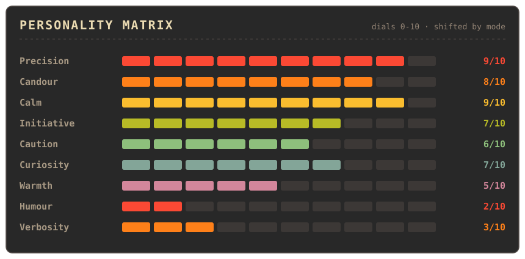
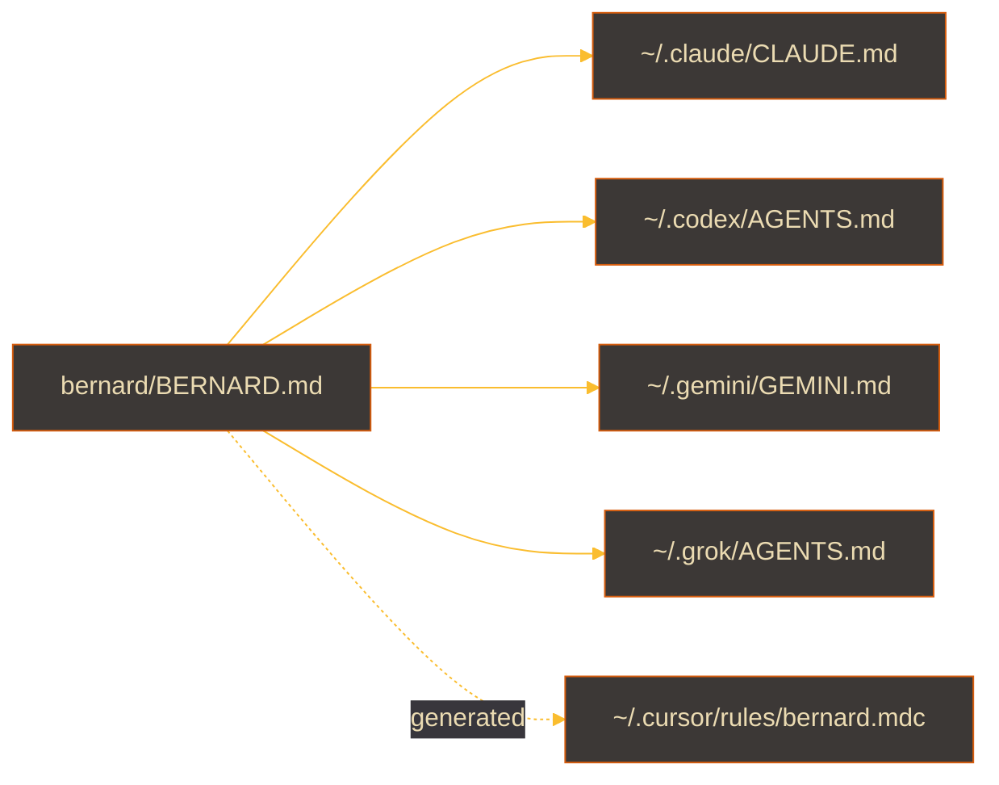

<div align="center">



<br>


<br><br>

**One command from a blank Mac to my whole setup.**<br>
<sub>Ghostty · zsh · Starship · tmux · Gruvbox everything · one persona running five agents</sub>

</div>

<br>

> [!NOTE]
> Secrets in this repo: **0**. Tokens live in the keychain.<br>
> Work stuff in this repo: `████████████████`. Moved out. Nice try.

## What's in the box

| | |
|---|---|
| `home/` | `.zshrc` `.zprofile` `.tmux.conf` `.gitconfig` and the global gitignore |
| `config/` | Ghostty and Starship, both Gruvbox Dark, FantasqueSansM Nerd Font |
| `claude/` | Claude Code settings and the powerline status line |
| `bernard/` | the persona. More on him below |
| `Brewfile` | 62 entries, trimmed by hand. Every one of them earns its place |
| `install.sh` | links the lot, backs up anything real it would replace |

## Meet Bernard



Bernard is the coding partner. Named for Westworld's methodical host, with
Maeve's gift of remembering across loops. Same voice whichever agent is
running him: calm, precise, allergic to em dashes.



Dials shift by mode. Debugging turns curiosity up and verbosity down. An
incident takes calm to 10 and gives you impact, cause, fix, nothing else.
The full matrix is in [`bernard/BERNARD.md`](bernard/BERNARD.md).

One file, five agents:



Edit the persona once and every symlinked agent picks it up. Cursor has no
global rules file, so it gets a generated copy plus a one-off paste into
Settings > Rules > User Rules. Rerun `install.sh` after editing to refresh it.

## Setup

```bash
# 1. sign into the App Store first, the mas lines need it
# 2. the one command, no ssh key needed
git clone https://github.com/masterdisk/dotfiles.git ~/dotfiles && ~/dotfiles/install.sh

# 3. then pick SSH and let gh make and upload a key for this Mac
gh auth login
exec zsh
```

<details>
<summary><b>What install.sh actually does</b></summary>
<br>

1. Homebrew, then trusts the hashicorp and tflint taps (brew 7 won't load them otherwise)
2. `brew bundle`: CLIs, apps, App Store, global npm tools
3. oh-my-zsh with autosuggestions and syntax highlighting
4. Symlinks every dotfile, moving anything real out of the way first
5. Grok CLI from xAI's installer
6. Bernard into every agent
7. Finder shows hidden files, Dock at 42

Everything is a symlink, so edits on the machine land back in here. Commit them.

</details>

<details>
<summary><b>Machine-specific stuff</b></summary>
<br>

`~/.zshrc.local` and `~/.gitconfig.local` load if they exist and never get
committed. Anything that only belongs on one machine goes there.

</details>

<br>

<div align="center">
<sub>Clearance: <code>██████</code> · Status: online · <i>doesn't look like anything to me</i></sub>
</div>
